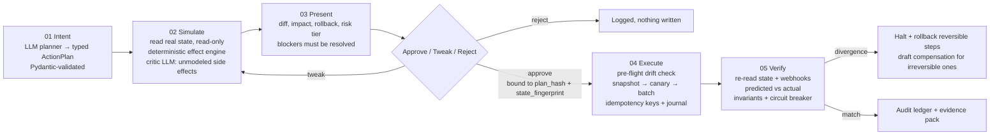

# Simulate Before You Act: execution plan

Status: v2, decisions recorded (2026-11-14). Deadline 2026-12-15; aim to submit 2026-12-13.
Decisions are in section 10. Account setup steps are in [setup.md](setup.md).

---

## 1. What the judges reward, and what that means for the design

| Weight | Criterion | Design response |
|---|---|---|
| 25 | Simulation changes the decision | The simulator reads **real current state** and returns **blockers** that change the plan (exclude these 3 customers, swap free text for a template). The Approve button stays disabled until every blocker is resolved. Any tweak re-simulates and produces a new plan hash. |
| 25 | Real preview + real rollback | Effects are computed by code from live API reads, never by the LLM. Each action declares its reversibility class and a concrete rollback or compensation. Reversible steps snapshot their state before they write. |
| 20 | Reviewer feels safe in 90s | One screen: a before/after diff, impact counts, money totals, who is affected, the rollback path and a risk tier. One click to approve, tweak or reject. |
| 15 | Wrong prediction caught downstream | Five safety nets: pre-flight drift check, canary batch, post-condition invariants, a circuit breaker, and a predicted-vs-actual reconciliation report. |
| 15 | Future thesis | Approvals bind to simulations, not intents, and measured simulator accuracy is what earns an agent autonomy (section 9). |
| Bonus | Diff view; real API | A diff of each record before and after. Runs against the real Telegram Bot API and a Neon Postgres CRM, not mocks. |
| DQ | "Are you sure?" dialog | Avoided by construction: there's no generic confirm. Approval is a signed binding to a specific simulated plan and state fingerprint. |

---

## 2. The product: "DOO Ops Copilot" with a simulation gate

The scenario comes straight from DOO's homepage, which shows the sample "I was charged twice" and the analytics line "Duplicate-charge complaints are up 12%".

> **Operator types:** "Credit back everyone who was double-charged yesterday, apologize on Telegram in their language, and tag them `dup-charge-2026-11`."

The agent turns that into a typed plan with three action kinds. Each kind sits in a different reversibility class, which is what makes the rollback story honest:

| Action | Real system | Reversibility | Rollback / compensation |
|---|---|---|---|
| `issue_credit` (**high stakes: moves money**) | Wallet ledger in the Neon CRM (append-only; see ADR 0004) | **Compensable** | A matching debit while the balance still covers it. Once the customer has spent it, only a drafted recovery request remains, and the simulator says so plainly. |
| `send_message` (**mass message**) | Telegram Bot API (DOO-style inbox; no DOO API access) | Recallable for 48h via `deleteMessage`, after the customer may already have read it | A hold queue with a 30s undo window, a real `deleteMessage` recall, then an auto-drafted correction message |
| `update_contact_attributes` | Postgres CRM shaped like DOO's `contacts` / `custom_attributes` API | **Reversible** | Restore from the pre-write snapshot |
| `delete_contacts` (**data deletion**) | Postgres CRM | Reversible during a 24h soft-delete window, then irreversible purge | Undelete from the snapshot before the purge timer fires |

The CRM adapter mirrors DOO's REST shapes (`/contacts`, `/contacts/:id/custom_attributes`), so swapping in the real DOO API later is one adapter. Stretch, only if time allows: `deploy_agent_config` (GitHub PR merge, rollback by revert).

**Reviewer as a real customer:** the reviewer can open the demo bot in Telegram and press Start. They are then added to the CRM as a customer and receive the real apology message on their own phone, and they watch the recall delete it.

### What the simulation finds (examples that change the decision)
- **Already credited:** 2 customers got a manual credit from a human agent. They are excluded automatically, and the diff shows why.
- **Disputed:** 3 charges are disputed with the bank, so a credit would reimburse them twice. This is a **blocker**: exclude them, or include them with a written reason.
- **WhatsApp 24-hour window:** 7 contacts are outside the session window, so a free-text message will fail. The simulator proposes an approved template for them.
- **Money:** total $X credited, the new balance of every wallet, N customers in each language (EN/AR). The Arabic preview renders right-to-left.
- **Policy tier:** over $500 total, or over 50 recipients, is tier HIGH: canary-first execution and a 10-minute approval expiry.

---

## 3. Architecture: intent → simulate → present → execute/rollback



**Principles**
1. **The LLM proposes; code disposes.** The LLM writes the plan and the narrative. Every number in the simulation comes from code reading real state.
2. **Approval is a binding, not a click.** `plan_hash = sha256(canonical plan)`, and `state_fingerprint` hashes the read-set (ids plus `updated_at` and `credited_amount`). The executor refuses a stale or mismatched approval. This adapts ECC's `operator-approval-loop`: epoch-keyed decisions and claim → dispatch → complete/unknown.
3. **Every stage ends at a check** (ICM invariant 6). A fail stops the run there, so the gate is the architecture itself, not decoration.
4. **Customer text is untrusted input.** It's treated as data, policy caps are enforced in code, and the planner can't raise limits (ECC `agent-security-hardening`).
5. **The critic uses a different model family from the planner**, to avoid same-model blind spots.

---

## 4. Failure test (deliverable): the simulation under-predicts and the safety net catches it

There are two scripted failure modes, both available as toggles in a **Failure Lab** tab:

1. **State drift between approval and execution.** After approval, a "human agent" credits one customer through the CRM admin (a real database write). The pre-flight check finds a fingerprint mismatch, halts that item, re-simulates only the change, and asks for re-approval of that part. Nobody is credited twice.
2. **An unmodeled side effect.** The CRM has an automation rule, like a DOO "Flow": any tag containing `charge` opens a billing ticket and sends the customer a Telegram notice. In failure mode, the simulator deliberately doesn't read the flow rules. The canary batch (5%) shows unexpected tickets and messages that the simulation didn't predict, so the circuit breaker halts the plan. The tags then roll back, the tickets close, and the stray notices are recalled with `deleteMessage`. The reconciliation report shows predicted vs actual, and the gap becomes a new simulator rule plus a regression eval.

Supporting nets: post-condition invariants (sum of credits ≤ sum of duplicates, no customer credited twice), single-flight execution locks, and `unknown` outcomes that are never auto-retried.

---

## 5. Tech stack (Python-first, as simple as the brief allows)

| Layer | Choice | Why |
|---|---|---|
| UI | **Gradio Blocks** (current major), mounted on FastAPI | Your preference; fast to build; `gr.Dataframe` handles one-step tweaks and `gr.HTML` the diff |
| Server | **FastAPI** (one process) | Telegram webhook (secret-token header), `/healthz` for Render, `gr.mount_gradio_app` |
| Models | **Pydantic v2** | ActionPlan, Simulation, Effect, Approval, JournalEntry; JSON schema for LLM structured output |
| LLM | `openai` SDK against OpenAI-compatible endpoints | One client for **Groq** (fast planner), **OpenRouter** and **Gemini** (critic/fallback); keys are already in `.env` |
| HTTP | `httpx` | Telegram adapter; the CRM adapter uses SQLAlchemy |
| Storage | **Neon free Postgres** (SQLite locally) via SQLAlchemy | Render's free Postgres **expires after 30 days**, and judging runs past Dec 15; Render's disk is ephemeral |
| Tests | pytest, recorded API fixtures, scenario evals | ECC `python-testing`, `eval-harness`, `ai-regression-testing` |
| Deploy | `render.yaml` (free web service) | Health check, env vars; note the ~1-minute cold start after 15 min idle |

**UI theme: Navy-inspired tokens** (pulled with Firecrawl's branding format): background `#F8F7F4`, ink `#1A1815`, muted text `#77746F`, secondary surface `#ECEAE6`, radius 6px, 4px spacing grid, Helvetica Neue / Switzer-style sans, `///` eyebrow labels, italic emphasis in headings, calm low-contrast layout. Implemented as a custom `gr.themes.Base` plus a small CSS file. **The Navy theme is a paid Lexington product ($99)**, so we reproduce the *look* with our own tokens and CSS and copy none of its code, images or logo, unless you own a license (question Q4).

Alternative if pixel-fidelity matters more than speed: FastAPI + Jinja + HTMX + Tailwind. It's still all Python on the server, but expect about 30% more UI work. My recommendation is Gradio.

---

## 6. Repository structure (ICM: the folder structure *is* the agent architecture)

The runtime pipeline is an ICM **Pipeline** form. The stage `CONTEXT.md` files are loaded **at runtime as the stage prompts and contracts**, so ICM drives behavior rather than documenting it.

```
Simulate-Before-You-Act/
├─ AGENTS.md                 L0 entry (<60 lines): what this is, where things live, routing
├─ CLAUDE.md                 one line: @AGENTS.md
├─ CONTEXT.md                L1: the 5-stage pipeline and the one rule (no stage advances past a failed check)
├─ README.md                 humans: demo link, quickstart, deliverables, notes for judges
├─ _shared/                  factory (stable every run; loaded as reference context)
│  ├─ action-catalog.md      each action: reversibility class, simulator, rollback
│  ├─ risk-policy.md         tiers, thresholds, blocker rules, approval expiry
│  └─ doo-voice.md           tone for customer messages, EN + AR
├─ _meta/schema.md           plan / simulation / journal schema (points to the Pydantic models)
├─ _templates/               scenario.md, run-report.md
├─ stages/
│  ├─ 01_intent/CONTEXT.md   inputs → typed plan; check: schema + policy validation
│  ├─ 02_simulate/CONTEXT.md read-set → effects, side effects, blockers; check: no unresolved blockers
│  ├─ 03_present/CONTEXT.md  simulation → diff + summary; check: human decision recorded
│  ├─ 04_execute/CONTEXT.md  approved plan → journaled writes; check: fingerprint + canary
│  └─ 05_verify/CONTEXT.md   predicted vs actual; check: invariants hold or roll back
├─ src/sba/
│  ├─ domain/                models.py, hashing.py, policy.py
│  ├─ adapters/              telegram.py, crm_db.py (contacts, charges, wallet ledger; each: read / simulate / execute / verify / compensate)
│  ├─ agents/                planner.py, simulator.py, critic.py, executor.py, verifier.py
│  ├─ llm/router.py          Groq / OpenRouter / Gemini with fallback and a budget cap
│  ├─ store/                 journal.py, approvals.py (claim → dispatch → complete / unknown)
│  ├─ ui/                    app.py, theme.py, diff.py, navy.css
│  └─ main.py                FastAPI + Gradio mount + webhooks + /healthz
├─ tests/                    unit/, scenarios/, failure/
├─ evals/                    simulator-accuracy suite (predicted vs actual)
├─ scripts/                  seed_demo.py, reset_demo.py
├─ runs/_examples/           one golden run (ICM "examples"); live runs are gitignored
├─ docs/                     architecture.md, failure-test.md, thesis.md, loom-script.md, adr/
├─ render.yaml  pyproject.toml  .env.example  .gitignore
```

**Kept local and gitignored:** `_local/ecc`, `_local/icm-architect`, and `.claude/`, which holds the selected ECC agents and skills, icm-architect installed as a skill, and ECC's rules under `.claude/rules/ecc/`. ICM's `links.py` and `viz.py` run from `_local/` against the repo and are never copied into it.

### What we take from each repo
- **icm-architect:** the AGENTS.md entry and routing, CONTEXT.md contracts (inputs, process, outputs, check), the factory/product split, `check.md` pass/fail verdicts, and the walk test plus `links.py` as a structural check.
- **ECC skills:** `operator-approval-loop` (hash-bound approvals, epoch rotation, claim states), `eval-harness` (simulator-accuracy evals, pass^k), `verification-loop` (pre-submit gate), `agent-security-hardening` (prompt injection from customer text), `cost-aware-llm-pipeline` (model routing, budget cap), `python-patterns`, `python-testing`, `deployment-patterns`, `architecture-decision-records`.
- **ECC agents (dev time only):** `planner`, `architect`, `tdd-guide`, `python-reviewer`, `security-reviewer`, `silent-failure-hunter`.
- **ECC rules:** `rules/common/*` and `rules/python/*`, imported via `CLAUDE.local.md`.

---

## 7. Phased execution plan

Each phase ends at a check, in the ICM style. Nothing moves on until the check passes.

**Progress (2026-11-14):**
- **P0** done, except the Render deploy, which is the owner's step.
- **P1** done. The live simulation on Neon reproduces the hand-computed numbers (`tests/test_simulator_scenario.py`). A live run caught network errors being reported as "customer blocked the bot"; that's fixed.
- **P2** done; 35 tests pass. Live on Neon with the real planner (Groq gpt-oss-120b) and critic (Gemini 3.5 Flash-Lite):
  - The full run matched its prediction.
  - The blind-spot run was halted by the canary and rolled back 11 writes.
  - The drift run was refused before any write.
  - Live runs also caught two more problems, both fixed: the planner mistyping a label, which made the deletion silently match nothing (now a blocker that suggests the real label), and drift reports listing clock-only changes.
  - They found one real-world gap that's documented, not fixed: the CRM's own automation notifies opted-out customers.
  - Evidence is in `runs/_examples/`.
- **P3** done; 53 tests pass. Both surfaces were tested live with the real models against Neon:
  - **Web review screen:** a web run applied the fixes, accepted the automation, ran 19 writes that matched the prediction, then rolled back 19 of 19.
  - **Telegram bot:** the owner tested from their phone, with buttons bound to plan hashes. See [ADR 0005](adr/0005-public-demo-sandboxes-and-telegram.md).
  - **Fixes from the live runs:**
    - The `getUpdates` timeout clash, and the poller dying on one dropped connection.
    - Bot replies lost to connection drops (now retried, because nothing was sent).
    - Browser sessions lost on every restart.
    - The example request stuck on the planner's mistyped label (now a one-click fix).
    - Tweaks re-running the critic (26 s; now reused).
    - The SDK's 16 s wait on rate limits (now falls through to the next model).
    - Too many database round trips: a simulation went from 47 queries and 23 s to 9 queries and 1.6 s from the Gulf; execution from 188 to 96 queries.

| Phase | Dates | Work | Exit check |
|---|---|---|---|
| **P0 Setup + walking skeleton** | Nov 14–16 | Answer the open questions; `git init`, set the repo-local git identity, first push; ICM skeleton (AGENTS.md, CONTEXT.md, stage contracts); install ECC/ICM locally in `.claude/`; Telegram bot; Neon DB; **deploy a hello-world Gradio+FastAPI to Render on day 1** | Live URL serves `/healthz`; clean clone runs `pytest`; `links.py` passes |
| **P1 Domain + adapters** | Nov 17–22 | Pydantic models, canonical hashing, policy engine; adapters with real read / simulate / execute / verify / compensate; `seed_demo.py` creates contacts, wallets and duplicate charges | Scenario test: simulation of the seeded dataset matches hand-computed numbers exactly |
| **P2 Agents** | Nov 23–28 | Planner (structured output), critic (second model), executor (pre-flight, snapshot, canary, idempotency keys, journal), verifier (predicted vs actual, invariants, circuit breaker) | End-to-end run in the CLI: intent → simulate → approve → execute → verify, with journal entries |
| **P3 UI** | Nov 29–Dec 3 | Gradio Navy theme; review screen (diff, impact, rollback, risk, blockers); one-step approve/tweak/reject; live execution timeline; audit log; Arabic RTL preview | A cold reviewer understands and approves in under 90s (time a friend) |
| **P4 Failure Lab + evals** | Dec 4–7 | Drift and unmodeled-side-effect toggles; reconciliation report; simulator-accuracy eval suite | Both failure modes caught; eval report committed |
| **P5 Harden + deploy** | Dec 8–10 | Per-visitor sandbox, reset button, rate limits, daily LLM budget cap, HMAC webhook checks, secrets audit (ECC `security-reviewer`), cold-start note | `verification-loop` PASS; demo survives 10 parallel visitors |
| **P6 Deliverables** | Dec 11–13 | `docs/architecture.md` (diagram), `failure-test.md`, `thesis.md` (≤300 words), `loom-script.md`, README notes (AI tools used, decisions, out of scope); record the Loom | Submission checklist complete; **submit Dec 13** |
| Buffer | Dec 14–15 | Fixes only | — |

---

## 8. Risks and mitigations

| Risk | Mitigation |
|---|---|
| No DOO API access on the free plan | Telegram bot + Postgres CRM fallback behind the same adapter interface; switch with one env var |
| Public demo abused (spam, LLM cost) | Per-session sandbox, 5 runs per session, daily token budget, messages only go to chats that pressed Start on our bot, wallets are per-session sandbox rows |
| Render cold start (~60s) | One-line note in the submission; optional uptime ping (one always-on service uses ~744 of the 750 free hours) |
| Render free Postgres expires on day 30 | Neon free Postgres instead; SQLite for local dev |
| LLM returns bad JSON or hallucinated numbers | Schema-validated output with retry, numbers only from code, critic output treated as advisory |
| Same model plans and reviews | Critic uses a different provider/model family |
| Render blocks SMTP ports | No email over SMTP; HTTP APIs only |
| Global git identity is the placeholder "Your Name" | Set a repo-local `user.name` / `user.email` in P0 before the first commit |

---

## 9. Two-year thesis: seed ideas (final text ≤300 words in P6)

- Every agent tool will ship with a `simulate()` contract, just as every API ships with an OpenAPI spec. Write tools without one won't be allowed in production agents.
- **Approvals bind to simulations, not intents.** The approved artifact is a hashed plan plus a state fingerprint, which makes approvals auditable and non-transferable.
- **Calibration becomes the trust currency.** Each action class tracks predicted-vs-actual error. Agents graduate from "approve every time" to auto-approve per action class once measured error stays under a threshold, and they're demoted on the first miss.
- Regulated MENA sectors (banking, telecom, government; see DOO's Khaleeji Bank MoU on agent payments) will require pre-execution impact statements. Simulation-gated execution becomes a compliance feature, and DOO's CTRL is the natural place for it.

---

## 10. Decisions (2026-11-14)

| # | Topic | Decision |
|---|---|---|
| 1 | Messaging system | **Telegram Bot API.** There's no DOO API access; the CRM mirrors DOO's API shapes. |
| 2 | Gated actions | **A mix:** wallet credit (money), mass message, attribute update and contact deletion in one remediation plan. Config deploy is a stretch. |
| 3 | Accounts | Telegram BotFather and Neon Postgres (both set up 2026-11-14; see [setup.md](setup.md)). **Stripe dropped** the same day: money moves as wallet credits in our own ledger ([ADR 0004](adr/0004-wallet-credits-instead-of-stripe.md)). |
| 4 | Theme | A close visual replica of Navy, **written from scratch**: same palette, type scale, spacing, radii and layout rhythm. None of their source files, images, logo or copy are copied, because it's a paid theme and we don't hold a license. |
| 5 | Git identity | Repo-local `user.name = Ahmed Salama`; email from your existing global config. No AI co-author lines. |
| 6 | UI | Gradio on FastAPI |
| 7 | LLMs | Groq for the planner, Gemini or OpenRouter for the critic, with a daily budget cap |
| 8 | Languages | Arabic + English previews, with RTL rendering |
| 9 | Public demo | Open to anyone with no passcode, but sandboxed and rate-limited |
| 10 | Tooling | ECC/ICM installed into the project's gitignored `.claude/` folder |
| 11 | Loom | You record it; I write the script and a deterministic demo seed |

---

## 11. Extra ideas (stretch)

- **Counterfactual view:** "credit now vs a discount on the next order" side by side, each with its simulated effects.
- **Evidence pack:** a downloadable zip per run (plan, simulation, approval, journal, verification). It's the ICM "status on disk" idea made portable for auditors.
- **Simulator accuracy badge** on the dashboard ("97% over 42 runs"), which feeds the thesis.
- **Webhook-driven verify:** Telegram updates (deliveries, replies) confirm effects asynchronously, so the reconciliation is evidence-based.
- **MCP server:** expose `simulate_action` as an MCP tool so any agent (including DOO's) can call the gate. This makes a strong thesis demo if time allows.
